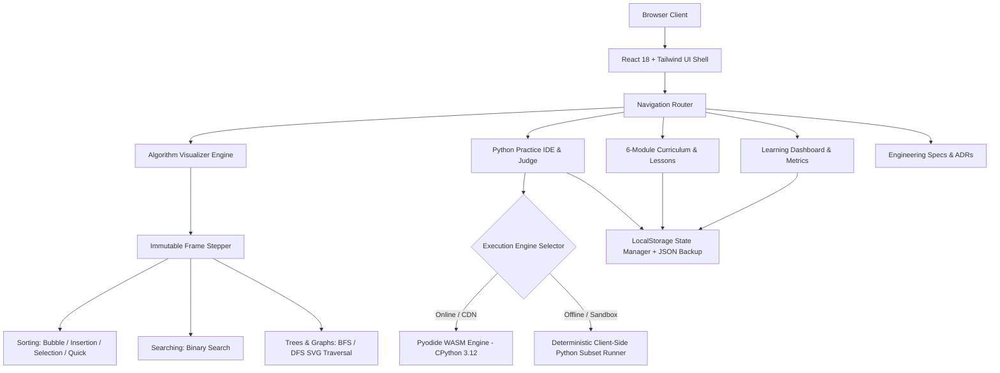

<div align="center">

# ⚡ DSA Mastery — Interactive Python Algorithms Platform

**Zero-cost (`₹0/month` infrastructure target) interactive platform for mastering Data Structures and Algorithms in Python from core foundations to interview readiness.**

[](https://github.com)
[](https://react.dev/)
[](https://www.typescriptlang.org/)
[](https://tailwindcss.com/)
[](https://pyodide.org/)
[](https://github.com)

[🚀 Live Preview](#-deployment--zero-cost-hosting) •
[📚 Curriculum Roadmap](#-curriculum-roadmap) •
[🎨 Visualizer Studio](#-algorithm-visualizer-studio) •
[💻 Python Practice IDE](#-python-practice-ide--in-browser-judge) •
[⚡ Quick Start](#-quick-start)

---

</div>

## 🌟 Highlights & Key Features

- **🎓 6-Module Structured Curriculum**: From CPython memory layouts, pointer semantics, and Big-O asymptotic analysis to Trees, Graphs, and Dynamic Programming.
- **👁️ Interactive Algorithm Visualizer**: Step-by-step frame scrubbing (Play, Pause, Step Back, Step Forward, Speed 0.5x–4x) for Bubble Sort, Insertion Sort, Selection Sort, Quick Sort, Binary Search, and Tree/Graph BFS & DFS.
- **⚡ Dual-Engine Python Runtime**:
  - **Primary**: Full CPython 3.12 via [Pyodide WebAssembly](https://pyodide.org/).
  - **Fallback**: Built-in deterministic, zero-dependency client-side Python interpreter for 100% offline and low-bandwidth resilience.
- **💻 Problem Judge & Practice Workspace**: 8 LeetCode-aligned practice problems with starter templates, test runners, execution timers, progressive hints, and submission history.
- **🛡️ 100% Privacy & Persistence**: Guest learning progress, quiz scores, XP, bookmarks, and code snapshots persist locally in `localStorage` with JSON export/import capability.
- **🎨 Modern Visual System**: Built with modern dark-first design inspired by [React Bits](https://reactbits.dev/), featuring Spotlight Cards, animated grids, smooth theme toggling, and accessibility-first reduced motion controls.

---

## 🏛️ System Architecture



---

## 📚 Curriculum Roadmap

The curriculum is organized into 6 progressive modules covering critical interview patterns:

| Module | Title | Level | Core Topics |
| :--- | :--- | :--- | :--- |
| **01** | **Python Memory & Big-O Foundations** | Beginner | Asymptotic analysis, CPython list pointer arrays, amortized O(1) appends, `collections.deque` |
| **02** | **Arrays, Two Pointers & Sliding Window** | Beginner | In-place transformations, opposite-end pointers, variable-length sliding windows |
| **03** | **Stacks, Queues & Hash Maps** | Intermediate | LIFO monotonic stacks, FIFO queues, amortized O(1) hash map operations, collision resolution |
| **04** | **Sorting & Divide-and-Conquer** | Intermediate | Comparison sorts, Lomuto QuickSort partitioning, pivot selection, recursion trees |
| **05** | **Binary Search & Logarithmic Patterns** | Intermediate | Search boundary invariants, lower-bound / upper-bound binary searches, range elimination |
| **06** | **Trees, Graphs & Dynamic Programming** | Advanced | Breadth-First Search (BFS), Depth-First Search (DFS), memoization, 1D/2D bottom-up tabulation |

---

## 🎨 Algorithm Visualizer Studio

Every algorithm visualizer is built on a **deterministic immutable frame engine**, enabling learners to inspect variables and execution frames forward and backward:

```
[⏮ First]  [◀ Step Back]  [▶ Play / ⏸ Pause]  [Step Forward ▶]  [⏭ Last]  [🔄 Reset]
Speed: [──●─────] 1.0x    Array: [ 29, 10, 14, 37, 13 ]    Target: [ 14 ]
```

- **Bubble Sort**: Adjacent element comparisons with early-exit detection.
- **Insertion Sort**: Sorted prefix building with right-shift animation.
- **Selection Sort**: Unsorted suffix scanning and minimum element placement.
- **Quick Sort**: Lomuto partition scheme with pivot isolation and recursive boundary visualization.
- **Binary Search**: Logarithmic interval halving with dynamic `low`, `mid`, and `high` pointers.
- **Binary Tree BFS & DFS**: Interactive SVG node graph visualizing FIFO queue level-order vs. LIFO recursion stack depth traversal.

---

## 💻 Python Practice IDE & In-Browser Judge

The coding workspace allows learners to test and verify code against structured test suites:

- **Two Sum** (Hash Map lookup — $O(N)$)
- **Valid Parentheses** (Monotonic Stack — $O(N)$)
- **Binary Search** (Iterative Interval Halving — $O(\log N)$)
- **Valid Palindrome Array** (Two Pointers — $O(N)$)
- **Maximum Subarray** (Kadane's Dynamic Programming — $O(N)$)
- **Climbing Stairs** (Fibonacci DP Tabulation — $O(N)$)
- **Coin Change** (Unbounded Knapsack DP — $O(N \times \text{amount})$)
- **Trapping Rain Water** (Two Pointers / Elevation Trapping — $O(N)$)

---

## ⚡ Quick Start

### Prerequisites
- **Node.js**: v18+ or v20+ recommended
- **npm**: v9+ or v10+
- **Python**: 3.9+ (for release verification script)

### Installation & Run

```bash
# 1. Clone the repository
git clone https://github.com/your-username/dsa-mastery.git
cd dsa-mastery

# 2. Install dependencies
npm install

# 3. Start local development server
npm run dev

# 4. Build optimized production bundle
npm run build

# 5. Preview production build locally
npm run preview
```

### Automated Verification

Run the Python verification test suite to validate documents, curriculum integrity, and problem test suites:

```bash
python tests/verify_v01.py
```

---

## 📁 Repository Structure

```
DSA Site/
├── .github/
│   └── workflows/
│       └── deploy.yml          # GitHub Pages automated deployment pipeline
├── public/
│   └── _redirects              # Cloudflare Pages SPA client-routing rules
├── src/
│   ├── components/             # Reusable UI & views
│   │   ├── CurriculumAndDocsView.tsx
│   │   ├── PracticeWorkspaceView.tsx
│   │   ├── ReactBits.tsx       # Spotlight, ShinyText, TiltedCard components
│   │   └── VisualizerView.tsx   # Step-by-step algorithm animation studio
│   ├── data/
│   │   ├── curriculum.ts       # 6 modules & interactive Python lessons
│   │   └── problems.ts         # 8 Python practice problems & test suites
│   ├── engine/
│   │   ├── pythonRunner.ts     # Pyodide WASM + deterministic fallback runner
│   │   └── visualizerEngine.ts # Frame generation for Sorting, Searching, Graphs
│   ├── App.tsx                 # Main application shell & state container
│   ├── index.css               # Tailwind CSS base & utilities
│   ├── main.tsx                # React 18 DOM mount entry point
│   └── types.ts                # Strict TypeScript domain interfaces
├── tests/
│   └── verify_v01.py           # Automated test & release validation suite
├── .env.example                # Example environment variables
├── .gitignore                  # Git ignore rules for node_modules, dist, etc.
├── CHANGELOG.md                # Release version history
├── DECISIONS.md                # Architectural Decision Records (ADRs)
├── DEPLOYMENT.md               # ₹0 hosting guide & rollback procedures
├── package.json                # Project dependencies and npm scripts
├── postcss.config.js           # PostCSS Tailwind integration
├── PROJECT_PLAN.md             # Multi-phase engineering roadmap
├── README.md                   # Visual project documentation
├── tailwind.config.js          # Tailwind CSS styling configuration
├── TASKS.md                    # Work item tracker & backlog
├── tsconfig.json               # TypeScript compiler configuration
└── vite.config.ts              # Vite bundler configuration
```

---

## 🌐 Deployment & Zero-Cost Hosting

DSA Mastery is purpose-engineered to run completely within free-tier quotas (`₹0/month`):

| Provider | Free Quota | Routing Support | Deployment Method |
| :--- | :--- | :--- | :--- |
| **Cloudflare Pages** *(Primary)* | Unlimited static bandwidth, 500 builds/month | SPA routing via `public/_redirects` | Connect repo or upload `dist/` |
| **GitHub Pages** *(Secondary)* | 1 GB storage, 100 GB/month bandwidth | Automated via GitHub Actions | Push to `main` branch |

---

## 📄 License & Credits

- Built with [React](https://react.dev/), [TypeScript](https://www.typescriptlang.org/), and [Tailwind CSS](https://tailwindcss.com/).
- Visual design elements inspired by [React Bits](https://reactbits.dev/).
- Python in-browser runtime powered by [Pyodide](https://pyodide.org/).
- Distributed under the [MIT License](LICENSE).
